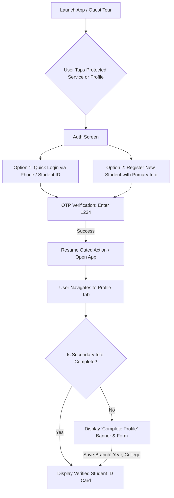

# 📋 Implementation Plan: Passwordless OTP Authentication & Two-Stage Profile System

This document details the architectural design and step-by-step implementation plan for transition to **Passwordless OTP-First Authentication** with standard demo OTP `1234`, and **Two-Stage Profile Onboarding** (Primary Info at Auth, Secondary Info on Profile Screen).

---

## 🎯 1. Overview & Goals

1. **Security & Frictionless Auth**:
   - As a campus payment app, remove traditional password inputs in favor of 2-factor ready verification.
   - For demo and development testing, verification uses standard OTP: **`1234`** (handled silently by testers without revealing demo badge in UI).
   - **Account Existence Verification**: During login, the app verifies if the account (by phone number, student ID, or email) already exists in the registered accounts registry or Supabase `profiles` table. If not found, login is prevented with *"No account found. Please sign up first."*. Similarly, sign up prevents duplicates if the phone or Student ID is already registered.
2. **Two-Stage Identity Gathering**:
   - **Stage 1 (Primary Info at Auth)**: First Name, Last Name, Phone Number (10 digits), Email Address (`@dbit.ac.in` or general), and Student ID (e.g. `DBIT2024021`).
   - **Stage 2 (Secondary Info on Profile Page)**: College Name, Engineering Branch / Department, and Year of Study.
3. **Interactive Profile Completion**:
   - If secondary information is incomplete, the Profile Screen prompts the student with a completion banner to finalize their academic record.
4. **Guest-to-User Continuity**:
   - Preserves the existing guest flow where onboarding and home tour come first, and authentication is requested only when accessing protected services or the profile.

---

## 🏗️ 2. Data Architecture

### 2.1 Student Profile Model (`lib/data/models/student_profile.dart`)

```dart
class StudentProfile {
  // ── Primary Information (Stage 1: Auth) ──
  final String firstName;
  final String lastName;
  final String phone;
  final String email;
  final String studentId;

  // ── Secondary Information (Stage 2: Profile Page) ──
  final String? collegeName;
  final String? branch;
  final String? year;

  const StudentProfile({
    required this.firstName,
    required this.lastName,
    required this.phone,
    required this.email,
    required this.studentId,
    this.collegeName,
    this.branch,
    this.year,
  });

  String get fullName => '$firstName $lastName'.trim();

  bool get isSecondaryComplete =>
      collegeName != null &&
      collegeName!.trim().isNotEmpty &&
      branch != null &&
      branch!.trim().isNotEmpty &&
      year != null &&
      year!.trim().isNotEmpty;

  StudentProfile copyWith({
    String? firstName,
    String? lastName,
    String? phone,
    String? email,
    String? studentId,
    String? collegeName,
    String? branch,
    String? year,
  });

  Map<String, dynamic> toJson();
  factory StudentProfile.fromJson(Map<String, dynamic> json);
}
```

### 2.2 Storage & Sync Strategy
- **Local Persistence (`SharedPreferences`)**:
  - Saved under key `campuspay_student_profile`.
  - Enables instant offline startup without network latency.
- **Remote Cloud Sync (`Supabase`)**:
  - When Supabase is connected, sync attributes into `auth.users` metadata and/or the `profiles` table.

---

## 🚀 3. Phase-by-Phase Implementation Plan



### Phase 1: Model & Storage Service
- [ ] Create `lib/data/models/student_profile.dart`.
- [ ] Upgrade `AuthService` in `lib/ui/auth/login_signup_page.dart`:
  - `static final ValueNotifier<StudentProfile?> currentStudent = ValueNotifier(null);`
  - Methods: `sendOtp({required String identifier})`, `verifyOtp({required String otp})`, `registerStudent(...)`, `updateSecondaryInfo(...)`.
  - Persist to `SharedPreferences` so session survives restarts.

---

### Phase 2: Redesign Auth UI (Passwordless OTP `1234`)
- [ ] Replace email/password form in `lib/ui/auth/login_signup_page.dart`:
  - **Tab 1: Login**
    - Input: Phone Number (10 digits) or Student ID (e.g. `DBIT2024021`).
    - Button: *"Send Verification Code"*.
  - **Tab 2: New Student Registration**
    - Inputs: First Name, Last Name, Phone Number, Campus Email ID, Student ID.
    - Button: *"Continue to Verification"*.
- [ ] **OTP Verification Screen / Subview**:
  - 4-Digit PIN input boxes with auto-focus movement.
  - Helper badge: *"Demo Code: 1234"*.
  - If code == `1234`: Complete login/registration, update `AuthService.currentStudent`, dismiss auth modal, and execute `onSuccess`.
  - If code != `1234`: Show vibration feedback & error message *"Invalid code. Please enter 1234"*.

---

### Phase 3: Profile Settings & Secondary Info Completion
- [ ] In `lib/ui/screens/profile_settings_screen.dart`:
  - Dynamically display the student's name, student ID, and email from `AuthService.currentStudent`.
  - If `isSecondaryComplete == false`:
    - Display an amber prompt card:
      > **Academic Profile Incomplete**
      > Add your College, Branch, and Academic Year to enable fee verification and campus rewards.
      > `[ Complete Profile Now ]`
  - Add **Secondary Information Completion Sheet / Dialog**:
    - **College Name**: Preset with *"Don Bosco Institute of Technology (DBIT Mumbai)"* (editable or selectable).
    - **Branch / Department**: Dropdown:
      - Computer Engineering
      - Information Technology
      - Electronics & Telecommunication (EXTC)
      - Mechanical Engineering
      - Artificial Intelligence & Data Science (AI & DS)
    - **Year of Study**: Segmented/dropdown picker:
      - FE (First Year)
      - SE (Second Year)
      - TE (Third Year)
      - BE (Fourth Year)
    - On Save: update `StudentProfile`, persist, and display verified status with green badge.

---

### Phase 4: Integration & Edge-Case Handling
- [ ] Ensure `StudentHomeScreen` greeting dynamically renders `Hey, <FirstName>` (or `Hey, Guest` when logged out).
- [ ] Profile avatar initial displays the student's first initial (e.g. `M` for Manya).
- [ ] Ensure guest flow is intact: users can tour, view home, and dismiss the login sheet with the `✕` button at any time.

---

### Phase 5: Verification & Quality Assurance
- [ ] Update `test/widget_test.dart` to cover:
  1. Login with Phone / Student ID -> OTP `1234` success.
  2. Registration with 5 primary fields -> OTP `1234` success.
  3. Rejection of incorrect OTP.
  4. Updating secondary fields on Profile Screen.
- [ ] Run `flutter analyze` (target: 0 issues).
- [ ] Run `flutter test` (target: 100% pass).

---

## ⏱️ Timeline & Sequencing

1. **Step 1**: Create `StudentProfile` model and upgrade `AuthService` logic.
2. **Step 2**: Rebuild `login_signup_page.dart` with Primary Info + OTP `1234` verification step.
3. **Step 3**: Enhance `profile_settings_screen.dart` with secondary info banner and edit modal.
4. **Step 4**: Verify all existing screens and test suite.
